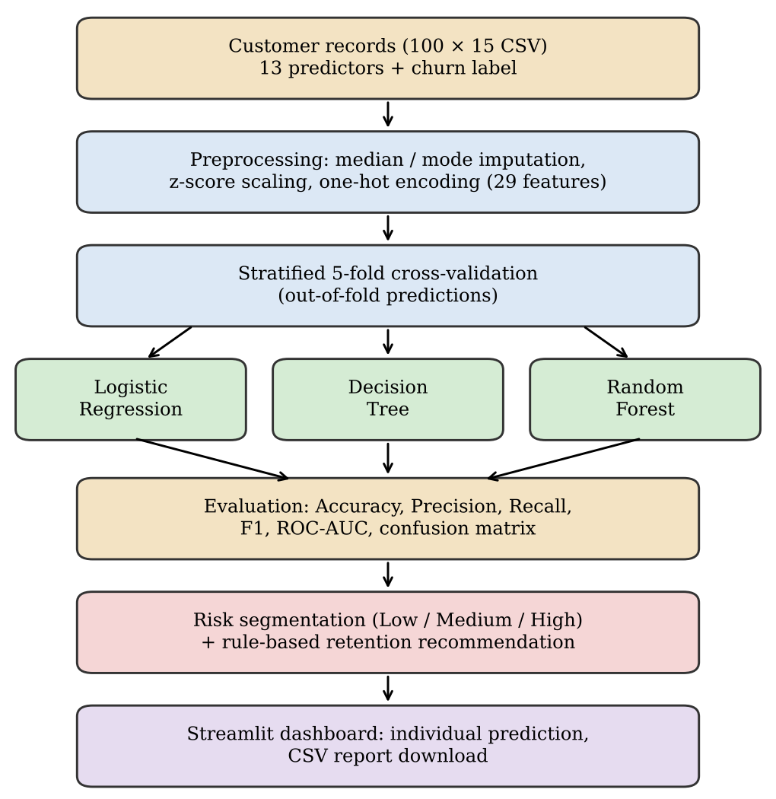
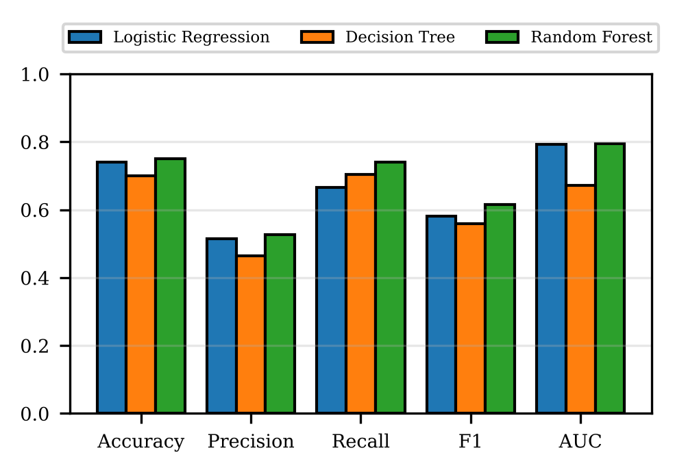
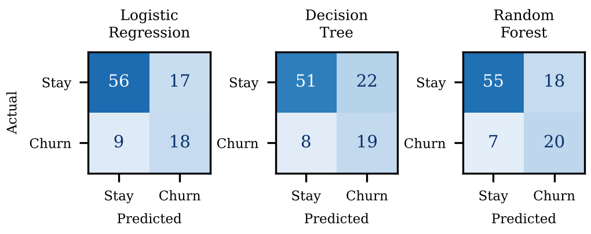
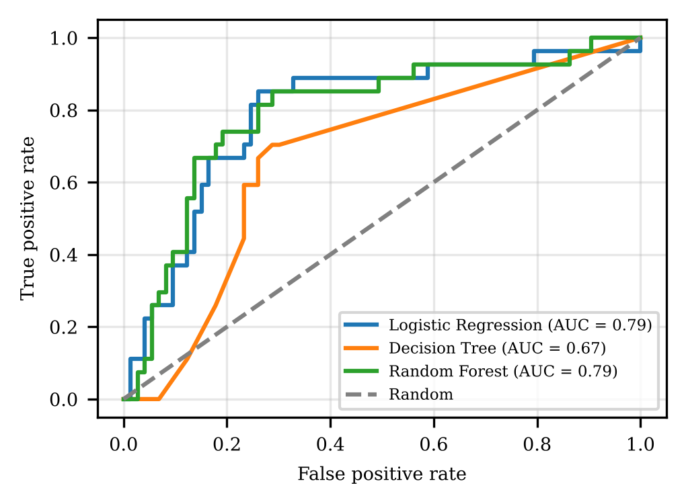
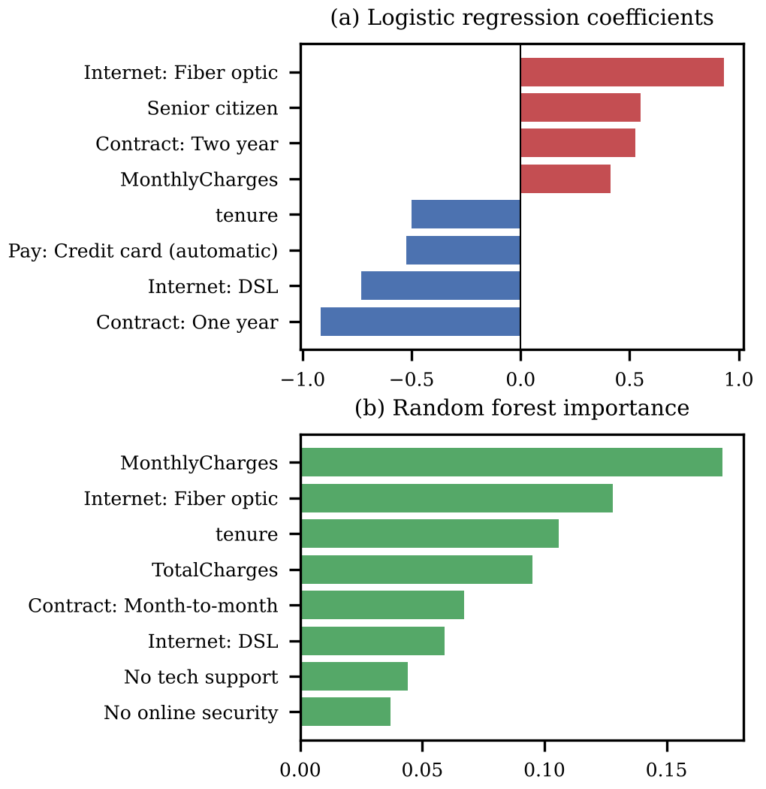

<div align="center">

# 📊 Customer Retention Intelligence
### Machine-Learning-Based Churn Prediction, Risk Segmentation & Retention Recommendation

An end-to-end Machine Learning system that predicts customer churn probability, classifies risk levels, and generates personalized retention strategies — accompanied by formal research, empirical evaluation, and an interactive Streamlit dashboard.

[](https://python.org)
[](https://streamlit.io)
[](https://scikit-learn.org)
[](paper/README.md)
[](LICENSE)

<br/>

[📖 **Read Research Paper**](paper/README.md) • [📄 **Download Word Doc**](paper/ML_Research_Paper_5CSE03.docx) • [🚀 **Launch App**](#launch-the-streamlit-dashboard) • [📓 **View Notebook**](Customer_Retention_Intelligence.ipynb)

</div>

---

## 👥 Authors & Research Team

Department of Computer Science and Engineering:

| Author | Student ID | Role / Specialization |
| :--- | :--- | :--- |
| **Rahul V** | `20241CSE1033` | Core Pipeline, Modeling & Dashboard |
| **Vivek GujaGonda** | `20241CSE1034` | Data Preprocessing & Validation |
| **Sudeep S Biradar** | `20241CSE1093` | Cross-Validation & Metric Evaluation |
| **Nagaraj M Gudda** | `20241CSE0149` | Risk Segmentation & Recommendation Engine |
| **Nagaraj N Naik** | `20251LCS3009` | Literature Review & Documentation |

---

## 🎯 Problem Statement

Customer churn is one of the most critical challenges for subscription-based businesses. Acquiring a new customer costs **5–25× more** than retaining an existing one. Most machine learning churn projects stop at classification accuracy; **Customer Retention Intelligence** bridges the gap between raw probability and business decision-making:

- **Predicts** customer churn probability using cross-validated classifiers
- **Segments** customers into **High / Medium / Low** risk tiers
- **Recommends** targeted, personalized retention offers based on risk and customer attributes
- **Visualizes** real-time inferences through an interactive Streamlit dashboard

---

## 🏗️ System Architecture

<div align="center">
  
  <p><em>Fig. 1. End-to-end framework: From raw customer records to retention recommendations and dashboard deployment.</em></p>
</div>

The architecture consists of five core stages:
1. **Data Ingestion & Cleaning:** Handling missing data, type casting, and splitting features.
2. **Preprocessing Pipeline:** Median imputation and z-score scaling for numerical attributes; most-frequent imputation and one-hot encoding for categorical variables (29 total inputs).
3. **Stratified 5-Fold Cross-Validation:** Out-of-fold predictions prevent data leakage across Logistic Regression, Decision Tree, and Random Forest.
4. **Risk Segmentation & Decision Engine:** Threshold-driven risk allocation coupled with multi-attribute business logic rules.
5. **Interactive UI Layer:** Streamlit interface for ad-hoc customer evaluations and batch report exports.

---

## 🔬 Experimental Results & Model Performance

Evaluated on 100 customer records (27% churn rate) using **Stratified 5-Fold Cross-Validation**:

### Model Comparison Table

| Model | Accuracy | Precision | Recall | F1-Score | ROC-AUC |
| :--- | :---: | :---: | :---: | :---: | :---: |
| **Logistic Regression** | 74.0% | 51.4% | 66.7% | 58.1% | 0.792 |
| **Decision Tree (depth 4)** | 70.0% | 46.3% | 70.4% | 55.9% | 0.672 |
| **Random Forest (200 trees)** | **75.0%** | **52.6%** | **74.1%** | **61.5%** | **0.795** |

<div align="center">
  
  <p><em>Fig. 2. Performance benchmark across 5 evaluation metrics.</em></p>
</div>

### Confusion Matrices & ROC Curves

<div align="center">
  <table>
    <tr>
      <td align="center"><b>Confusion Matrices (Out-of-Fold)</b></td>
      <td align="center"><b>ROC Curves Comparison</b></td>
    </tr>
    <tr>
      <td></td>
      <td></td>
    </tr>
  </table>
</div>

---

## 🎯 Risk Segmentation & Retention Recommendations

### Risk Calibration

Out-of-fold probabilities from Logistic Regression produce strong monotonic ordering:

| Risk Level | Probability Threshold | Customers | Actual Churned | Observed Churn Rate |
| :--- | :---: | :---: | :---: | :---: |
| 🟢 **Low** | $p < 0.30$ | 49 | 3 | **6.1%** |
| 🟡 **Medium** | $0.30 \le p < 0.60$ | 20 | 6 | **30.0%** |
| 🔴 **High** | $p \ge 0.60$ | 31 | 18 | **58.1%** |

> 💡 **Key Takeaway:** Contacting only the **High-risk segment** (31% of users) reaches **66.7% (18/27) of all churners**, cutting outreach costs by more than two-thirds.

### Recommendation Decision Matrix

| Trigger / Condition | Recommended Action |
| :--- | :--- |
| **Risk = High** | 15% bill discount for 3 months; personal retention call within 24 hours |
| **Risk = Medium** | 10% bill discount for 2 months; proactive plan review |
| **Risk = Low** | 5% loyalty discount; loyalty appreciation message |
| **Contract = Month-to-month** | Special incentive for switching to a 1-year contract |
| **TechSupport = No** | 1 month of free technical support trial |
| **OnlineSecurity = No** | 1 month of free online security add-on |
| **MonthlyCharges $\ge$ Median** | Review package for lower-cost alternative |

---

## 🔍 Influential Churn Drivers

<div align="center">
  
  <p><em>Fig. 3. Influential factors: (a) Logistic Regression coefficients, (b) Random Forest Gini importances.</em></p>
</div>

- **Tenure:** Higher tenure strongly reduces churn probability.
- **Contract Type:** Month-to-month contracts exhibit high churn rates; 1-year contracts provide stabilization.
- **Monthly Charges & Fiber Optic:** Higher bills and fiber optic subscribers showed significantly higher churn rates.
- **Technical Support:** Customers lacking support add-ons churned at 3× the rate of supported users.

---

## 📁 Repository Structure

```
Customer-Retention-Intelligence/
│
├── 📂 paper/                                  # Research paper assets
│   ├── README.md                              # Full formatted paper with math & tables
│   ├── ML_Research_Paper_5CSE03.docx          # Original submission Word document
│   └── 📂 figures/                            # High-resolution paper figures (1-6)
│
├── 📂 assets/                                 # Visuals for repository documentation
│   ├── fig1_architecture.png
│   ├── fig2_eda.png
│   ├── fig3_model_comparison.png
│   ├── fig4_confusion_matrices.png
│   ├── fig5_roc_curves.png
│   └── fig6_influential_factors.png
│
├── 📓 Customer_Retention_Intelligence.ipynb   # Complete ML pipeline, EDA & diagnostics
├── 🚀 app.py                                  # Modular Streamlit dashboard
├── 📄 Customer_Retention_100_Records.csv       # 100-record input dataset
├── 📊 Customer_Retention_Final_Results.csv     # Model predictions & risk output
├── 📋 requirements.txt                         # Python dependencies
├── 📝 README.md                                # Project overview & benchmarks
├── 🔒 .gitignore                               # Git exclusions
└── ⚖️ LICENSE                                  # MIT License
```

---

## ⚙️ Installation & Usage

### 1. Clone & Set Up Environment

```bash
# Clone the repository
git clone https://github.com/rahul-v-023/Customer-Retention-Intelligence.git
cd Customer-Retention-Intelligence

# (Optional) Create virtual environment
python -m venv venv
venv\Scripts\activate       # Windows
# source venv/bin/activate  # macOS/Linux

# Install dependencies
pip install -r requirements.txt
```

### 2. Launch the Streamlit Dashboard

```bash
streamlit run app.py
```

Features included:
- **Batch Analysis:** Browse full cohort churn probabilities and recommended actions.
- **Single Customer Prediction:** Enter contract, service, and charge details in real time.
- **CSV Downloads:** Export individual predictions or the entire batch report with one click.

### 3. Run the Jupyter Notebook

```bash
jupyter notebook Customer_Retention_Intelligence.ipynb
```

Execute all cells sequentially to reproduce the 5-fold cross-validation, metrics, confusion matrices, and ROC plots.

---

## 📄 Citation

If you use this project or research paper in your work, please cite it as:

```bibtex
@article{rahul2026customer,
  title={Customer Retention Intelligence: Machine-Learning-Based Churn Prediction, Risk Segmentation and Retention Recommendation},
  author={Rahul, V. and GujaGonda, Vivek and Biradar, Sudeep S. and Gudda, Nagaraj M. and Naik, Nagaraj N.},
  journal={Department of Computer Science and Engineering Technical Report},
  year={2026}
}
```

---

## 📜 License

This project is licensed under the **MIT License** — see the [LICENSE](LICENSE) file for details.

<div align="center">

⭐ **If you find this work helpful, please give the repo a star!** ⭐

</div>
