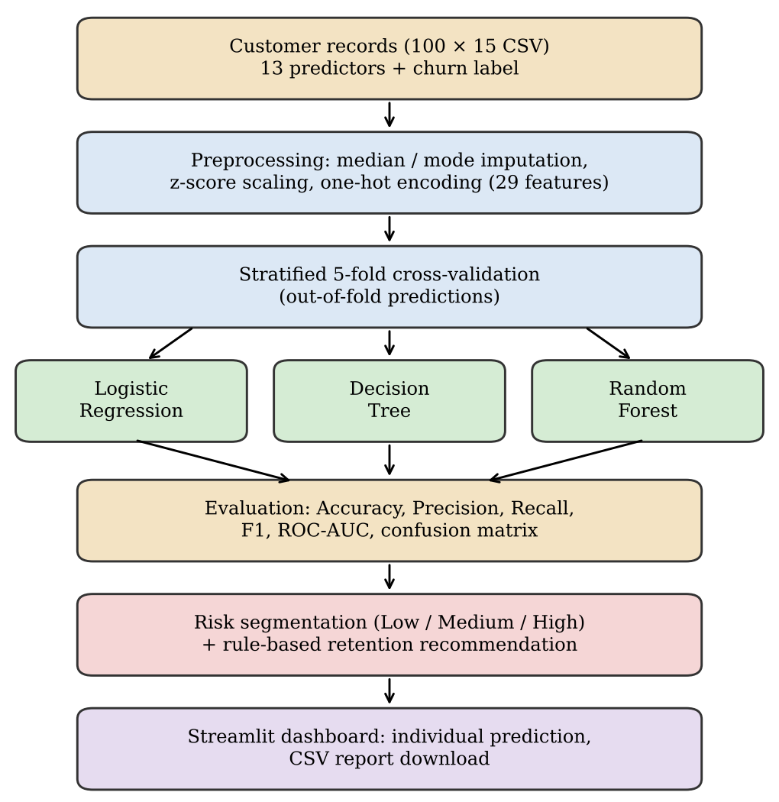
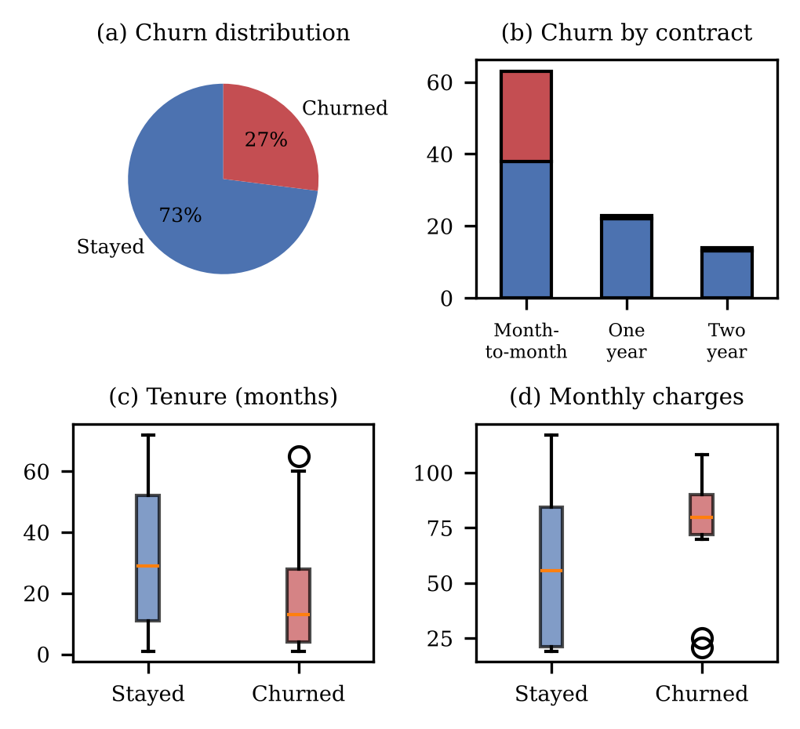
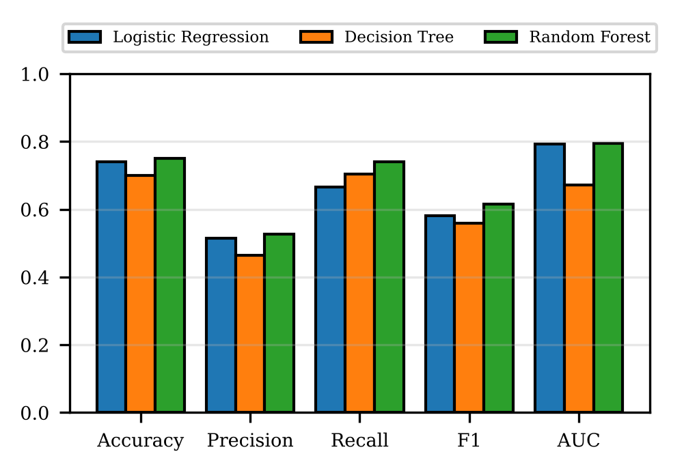
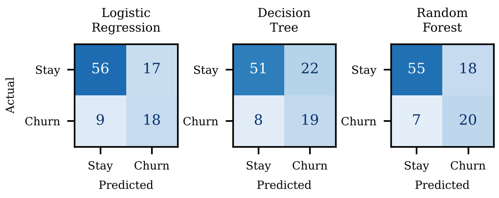
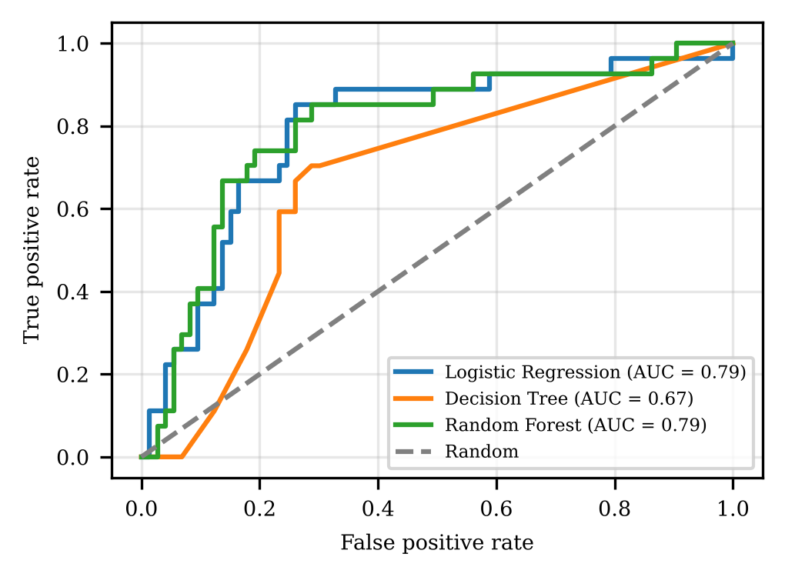
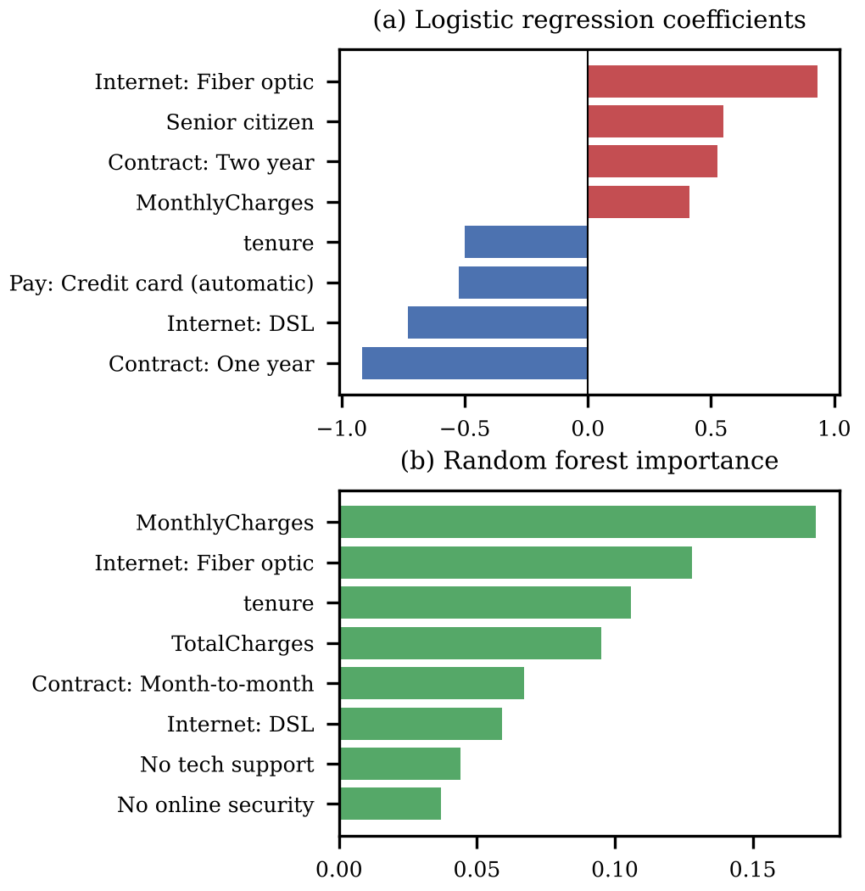

# Customer Retention Intelligence: Machine-Learning-Based Churn Prediction, Risk Segmentation and Retention Recommendation

> **Original Research Paper** | Department of Computer Science and Engineering  
> Document Source: [`ML_Research_Paper_5CSE03.docx`](ML_Research_Paper_5CSE03.docx)

---

### Authors & Affiliations

| Author | Student ID | Department |
| :--- | :--- | :--- |
| **Rahul V** | 20241CSE1033 | Computer Science and Engineering |
| **Vivek GujaGonda** | 20241CSE1034 | Computer Science and Engineering |
| **Sudeep S Biradar** | 20241CSE1093 | Computer Science and Engineering |
| **Nagaraj M Gudda** | 20241CSE0149 | Computer Science and Engineering |
| **Nagaraj N Naik** | 20251LCS3009 | Computer Science and Engineering |

---

## Abstract

Customer churn, the loss of subscribers to competitors, is a costly problem for subscription-based businesses because retaining an existing customer is generally cheaper than acquiring a new one. This work presents **Customer Retention Intelligence**, an end-to-end machine learning framework that predicts the probability that a customer will churn, assigns the customer a Low, Medium or High risk level, and recommends a personalised retention action. 

Customer attributes covering demographics, service subscriptions, contract type, billing and tenure are preprocessed using imputation, scaling and one-hot encoding, and three classifiers—**Logistic Regression**, **Decision Tree**, and **Random Forest**—are compared using 5-fold stratified cross-validation on a 100-record customer sample. The models are evaluated using accuracy, precision, recall, F1-score and ROC-AUC. 

Random Forest obtained the best F1-score (61.5%) and recall (74.1%), and Logistic Regression obtained a comparable ROC-AUC of 0.79 with 74% accuracy. The Logistic Regression risk segments were well ordered: 6.1%, 30.0% and 58.1% of customers in the Low, Medium and High segments actually churned. Contract type, internet service type, tenure and monthly charges were the most influential factors. The framework is also deployed as an interactive Streamlit dashboard. Because the sample is small, the results are indicative rather than conclusive.

**Keywords:** *Customer Churn, Retention Recommendation, Logistic Regression, Random Forest, Risk Segmentation, Cross-Validation, Machine Learning.*

---

## I. Introduction

Customer churn is the event in which a customer stops using the products or services of a company. In subscription-driven sectors such as telecommunication, streaming and banking, churn directly reduces recurring revenue, and acquiring a new customer is typically far more expensive than keeping an existing one [1]. Companies therefore try to identify customers who are likely to leave early enough to intervene with a suitable offer.

Traditionally, retention teams have relied on manual rules or on the judgement of account managers, which does not scale and cannot capture interactions between many customer attributes. Machine learning offers a data-driven alternative: a classifier trained on historical customer records learns which combinations of tenure, contract, services and charges are associated with leaving, and outputs a churn probability for each customer [2], [3].

A probability alone is not enough for a retention team. Managers need to know which customers to contact first and what to offer them. Many studies stop at classification accuracy and do not connect the prediction to an action. Furthermore, churn datasets are imbalanced, since far fewer customers leave than stay, so plain accuracy can be misleading and recall and F1-score must be examined as well [5].

The major contributions of the proposed work are:
1. **A preprocessing and modelling pipeline** that compares Logistic Regression, Decision Tree and Random Forest using 5-fold stratified cross-validation.
2. **A risk segmentation scheme** that converts out-of-fold churn probabilities into Low, Medium and High risk levels.
3. **A transparent rule-based engine** that recommends retention offers from the risk level and the customer profile.
4. **An interactive Streamlit dashboard** for individual prediction and downloadable reports.

The organization of the paper is as follows: Section II reviews related works. Section III describes the proposed framework and architecture. Section IV presents experimental analysis, metrics, and comparisons. Section V concludes the work, and Section VI outlines future scope.

---

## II. Related Works

Churn prediction has been studied extensively. Verbeke et al. [2] applied advanced rule-induction techniques to build comprehensible churn models, showing that interpretable rules can be competitive with black-box classifiers. Vafeiadis et al. [3] compared neural networks, support vector machines, decision trees, naive Bayes and logistic regression on telecommunication data and found that boosting improved the performance of the base classifiers. Coussement and Van den Poel [4] used support vector machines for churn prediction in subscription services and examined parameter-selection techniques.

Class imbalance is a recurring difficulty. Burez and Van den Poel [5] studied sampling methods and boosting for imbalanced churn data and showed that the choice of evaluation measure and of the imbalance-handling strategy affects the conclusions. Ahmad et al. [6] built a churn model for a telecom operator on a big-data platform, using extensive feature engineering and tree-based ensembles, with XGBoost giving the best performance.

### Table I. Summary of Representative Churn Studies

| Study | Approach | Main Observation |
| :--- | :--- | :--- |
| **Verbeke et al. [2]** | Rule induction (AntMiner+, ALBA) | Comprehensible models with competitive predictive power |
| **Vafeiadis et al. [3]** | ANN, SVM, DT, NB, LR with boosting | Boosted classifiers improved on base learners |
| **Coussement & Van den Poel [4]** | SVM with two parameter-selection techniques | SVM is effective for subscription-service churn |
| **Burez & Van den Poel [5]** | Sampling and boosting for class imbalance | Imbalance handling changes model ranking |
| **Ahmad et al. [6]** | Tree ensembles with feature engineering, big-data platform | XGBoost performed best on telecom data |

Most of these works focus on improving the predictive model. The present work instead combines a deliberately simple and interpretable set of models with a downstream decision layer: the probabilities are turned into risk levels and concrete retention actions, and the whole workflow is exposed through a dashboard so that a non-technical user can apply it to a new customer.

---

## III. The Proposed Methodology

The proposed Customer Retention Intelligence framework consists of five major stages: data preparation, model training with cross-validation, risk segmentation, retention recommendation, and deployment.

<div align="center">
  
  <p><em>Fig. 1. Overall architecture of the Customer Retention Intelligence framework</em></p>
</div>

Each stage is designed to contribute towards an integrated customer churn prediction and retention management system. Initially, historical customer records are collected and preprocessed to ensure data consistency, handle missing values, and transform categorical attributes into a suitable numerical representation. The numerical features are standardized, while categorical variables are encoded using one-hot encoding.

Following preprocessing, three classification algorithms—Logistic Regression, Decision Tree, and Random Forest—are trained and evaluated using stratified 5-fold cross-validation. Out-of-fold predictions are generated to obtain churn probabilities for individual customers without using predictions from models trained on their own records. The resulting probabilities categorize customers into Low, Medium, and High risk levels.

### A. Data Preparation

Each record describes one customer with 13 predictor attributes and a binary label, `Churn` (Yes if the customer left, No otherwise). The identifier `Customer_ID` is excluded from training. Numeric attributes (`SeniorCitizen`, `tenure`, `MonthlyCharges`, `TotalCharges`) are converted to numbers, missing values are filled with the median, and values are standardised to zero mean and unit variance. Categorical attributes are filled with the most frequent value and one-hot encoded, giving 29 model inputs. The entire preprocessing step is encapsulated in a pipeline together with the classifier to avoid data leakage.

```
Algorithm 1: Data Preparation and Preprocessing
────────────────────────────────────────────────────────────────────────
Input : Customer records (CSV)
Output: Encoded feature matrix X and label vector y

1. Import pandas and scikit-learn; read the CSV file.
2. Convert tenure, MonthlyCharges and TotalCharges to numeric values.
3. Map Churn: Yes → 1, No → 0 to obtain target vector y.
4. Drop Customer_ID and Churn to obtain feature matrix X.
5. Numeric columns: apply median imputation, followed by StandardScaler.
6. Categorical columns: apply most-frequent imputation, followed by OneHotEncoder.
7. Combine both branches using a ColumnTransformer.
```

### B. Classification Models

Three classifiers with complementary inductive biases are evaluated:
1. **Logistic Regression [7]:** Models the churn probability of a customer with feature vector $\mathbf{x}$ as:
   $$P(\text{churn} \mid \mathbf{x}) = \frac{1}{1 + \exp(-(\mathbf{w}^T \mathbf{x} + b))}$$
   where $\mathbf{w}$ and $b$ are learned weights and bias. Its coefficients provide direct interpretability.
2. **Decision Tree [8]:** Maximum depth of 4, splitting customers by attribute thresholds to yield human-readable decision rules.
3. **Random Forest [9]:** Ensemble of 200 trees (maximum depth 5) averaging decorrelated trees to reduce variance.

All models incorporate balanced class weights to penalize errors on the minority churn class.

### C. Risk Segmentation and Recommendation

Out-of-fold probabilities ($p$) are computed to ensure unbiased scoring. Churn classification uses threshold $p \ge 0.50$, and customers are segmented into risk tiers:
- **High Risk:** $p \ge 0.60$
- **Medium Risk:** $0.30 \le p < 0.60$
- **Low Risk:** $p < 0.30$

The recommendation engine pairs predicted risk with customer attributes to generate customized retention actions:

### Table II. Retention Recommendation Rules

| Condition | Recommended Action |
| :--- | :--- |
| **Risk = High** | 15% bill discount for 3 months; personal retention call within 24 hours |
| **Risk = Medium** | 10% bill discount for 2 months; plan review |
| **Risk = Low** | 5% loyalty discount; loyalty appreciation message |
| **Contract = Month-to-month** | Special discount for switching to a 1-year contract |
| **TechSupport = No** | One month of free technical support |
| **OnlineSecurity = No** | One month of free online security |
| **MonthlyCharges $\ge$ median** | Review plan for a lower-cost package |

```
Algorithm 2: Training, Risk Segmentation and Recommendation
────────────────────────────────────────────────────────────────────────
Input : X, y from Algorithm 1
Output: Performance metrics, risk level, and retention offers per customer

1. Define Logistic Regression, Decision Tree (depth 4) and Random Forest (200 trees, depth 5),
   all with class_weight = 'balanced'.
2. Wrap preprocessing and each classifier in a Pipeline.
3. Create StratifiedKFold with 5 splits, shuffle = True, random_state = 42.
4. Obtain out-of-fold labels and probabilities with cross_val_predict.
5. Compute accuracy, precision, recall, F1-score, ROC-AUC, and confusion matrix.
6. Assign Low / Medium / High risk from Logistic Regression probabilities (thresholds: 0.30, 0.60).
7. Apply Table II rules to build the personalized retention offer.
8. Save customer-wise results as CSV.
```

### D. Interactive Dashboard

The framework is deployed as a Streamlit web application. It trains the model pipeline on the sample, displays the customer-wise retention table, enables individual profile entry for real-time predictions, and exports both individual and aggregate reports as CSV.

---

## IV. Experimental Analysis

### A. Dataset

The experiments utilize a dataset of 100 customer records with 15 attributes following the telecommunication churn format. 27 customers churned and 73 stayed (27% churn rate).

### Table III. Dataset Attributes

| Group | Attributes |
| :--- | :--- |
| **Demographic** | `SeniorCitizen`, `Partner`, `Dependents` |
| **Account** | `tenure`, `Contract`, `PaperlessBilling`, `PaymentMethod` |
| **Services** | `InternetService`, `OnlineSecurity`, `OnlineBackup`, `TechSupport` |
| **Charges** | `MonthlyCharges`, `TotalCharges` |
| **Target** | `Churn` (`Yes` / `No`) |

<div align="center">
  
  <p><em>Fig. 2. Exploratory analysis of the customer sample</em></p>
</div>

**Key Exploratory Findings:**
- **Contract Impact:** 25 of 27 churners were on Month-to-month contracts (39.7% churn rate vs. 4.3% on One-year and 7.1% on Two-year).
- **Service Type:** Fiber optic customers churned significantly more often (24 of 47, 51.1%) than DSL customers (2 of 30, 6.7%).
- **Tenure & Charges:** Churners had shorter average tenure (19.2 vs. 32.4 months) and higher monthly bills (\$80.4 vs. \$57.3).
- **Support Add-ons:** Only 13.6% of customers with Tech Support churned, compared to 41.8% of those without it.

### B. Evaluation Protocol and Metrics

Stratified 5-fold cross-validation is employed to ensure reliable out-of-fold evaluation. The evaluation metrics are:

$$\text{Accuracy} = \frac{\text{TP} + \text{TN}}{\text{TP} + \text{TN} + \text{FP} + \text{FN}}$$

$$\text{Precision} = \frac{\text{TP}}{\text{TP} + \text{FP}}$$

$$\text{Recall} = \frac{\text{TP}}{\text{TP} + \text{FN}}$$

$$\text{F1-score} = 2 \times \frac{\text{Precision} \times \text{Recall}}{\text{Precision} + \text{Recall}}$$

### C. Model Comparison

### Table IV. Five-Fold Cross-Validated Performance (%)

| Model | Accuracy (%) | Precision (%) | Recall (%) | F1-Score (%) | ROC-AUC |
| :--- | :---: | :---: | :---: | :---: | :---: |
| **Logistic Regression** | 74.0 | 51.4 | 66.7 | 58.1 | 0.792 |
| **Decision Tree** | 70.0 | 46.3 | 70.4 | 55.9 | 0.672 |
| **Random Forest** | **75.0** | **52.6** | **74.1** | **61.5** | **0.795** |

<div align="center">
  
  <p><em>Fig. 3. Performance comparison across evaluation metrics</em></p>
</div>

<div align="center">
  
  <p><em>Fig. 4. Confusion matrices (out-of-fold predictions)</em></p>
</div>

<div align="center">
  
  <p><em>Fig. 5. ROC curves of the three models</em></p>
</div>

### D. Risk Segmentation Results

The out-of-fold probabilities from Logistic Regression produced well-calibrated, monotonic risk ordering:

### Table V. Observed Churn by Predicted Risk Level

| Risk Level | Customers | Actual Churned | Observed Churn Rate |
| :--- | :---: | :---: | :---: |
| 🟢 **Low** ($p < 0.30$) | 49 | 3 | **6.1%** |
| 🟡 **Medium** ($0.30 \le p < 0.60$) | 20 | 6 | **30.0%** |
| 🔴 **High** ($p \ge 0.60$) | 31 | 18 | **58.1%** |

Targeting only the **High-risk segment** (31% of customer base) successfully captures **66.7% (18/27) of all churners**, enabling highly efficient, resource-optimized retention campaigns.

### E. Influential Factors

<div align="center">
  
  <p><em>Fig. 6. Most influential factors: (a) Logistic Regression coefficients, (b) Random Forest feature importances</em></p>
</div>

Both models consistently identify **monthly charges, fiber optic internet, tenure, and contract type** as the primary indicators of customer churn.

### F. Discussion and Limitations

The experimental results demonstrate that machine learning models provide actionable insights into customer behaviour. However, several limitations should be noted:
1. **Sample Size:** The dataset contains 100 customer records (27 churners). A single misclassification alters recall by ~3.7 percentage points.
2. **Correlation vs. Causation:** Feature weights and importances reflect statistical associations within the sample, not causal mechanisms.
3. **Static Rule Verification:** Recommendation effectiveness has not yet been validated via live A/B testing in customer campaigns.

---

## V. Conclusion

This work presented **Customer Retention Intelligence**, an integrated framework combining churn prediction, risk segmentation, personalized retention recommendations, and a Streamlit dashboard. 

In 5-fold cross-validation:
- **Random Forest** achieved the best F1-score (61.5%) and recall (74.1%).
- **Logistic Regression** achieved 74.0% accuracy with an ROC-AUC of 0.792.
- Risk tiers exhibited clear monotonicity: 6.1% (Low), 30.0% (Medium), and 58.1% (High) churn rates.
- Focusing retention outreach on High-risk customers captures two-thirds of all churners while contacting less than a third of the customer base.

---

## VI. Future Scope

1. **Larger Real-World Datasets:** Validate across enterprise-scale multi-thousand customer datasets across industries.
2. **Additional Features:** Integrate behavioral data such as support ticket frequency, usage metrics, billing dispute history, and payment delays.
3. **Advanced Ensemble & Boosting Models:** Benchmark against XGBoost, LightGBM, and CatBoost with hyperparameter optimization.
4. **Explainable AI (XAI):** Incorporate SHAP (*SHapley Additive exPlanations*) and LIME for local customer-level interpretability.
5. **A/B Testing:** Evaluate financial ROI and retention lift through live marketing campaigns.

---

## References

1. Reichheld, F. F., & Sasser, W. E., "Zero defections: Quality comes to services," *Harvard Business Review*, vol. 68, no. 5, pp. 105–111, 1990.
2. Verbeke, W., Martens, D., Mues, C., & Baesens, B., "Building comprehensible customer churn prediction models with advanced rule induction techniques," *Expert Systems with Applications*, vol. 38, no. 3, pp. 2354–2364, 2011.
3. Vafeiadis, T., Diamantaras, K. I., Sarigiannidis, G., & Chatzisavvas, K. C., "A comparison of machine learning techniques for customer churn prediction," *Simulation Modelling Practice and Theory*, vol. 55, pp. 1–9, 2015.
4. Coussement, K., & Van den Poel, D., "Churn prediction in subscription services: An application of support vector machines while comparing two parameter-selection techniques," *Expert Systems with Applications*, vol. 34, no. 1, pp. 313–327, 2008.
5. Burez, J., & Van den Poel, D., "Handling class imbalance in customer churn prediction," *Expert Systems with Applications*, vol. 36, no. 3, pp. 4626–4636, 2009.
6. Ahmad, A. K., Jafar, A., & Aljoumaa, K., "Customer churn prediction in telecom using machine learning in big data platform," *Journal of Big Data*, vol. 6, article 28, 2019.
7. Hosmer, D. W., Lemeshow, S., & Sturdivant, R. X., *Applied Logistic Regression*, 3rd ed., Wiley, 2013.
8. Quinlan, J. R., "Induction of decision trees," *Machine Learning*, vol. 1, no. 1, pp. 81–106, 1986.
9. Breiman, L., "Random forests," *Machine Learning*, vol. 45, no. 1, pp. 5–32, 2001.
10. Pedregosa, F., et al., "Scikit-learn: Machine learning in Python," *Journal of Machine Learning Research*, vol. 12, pp. 2825–2830, 2011.
11. Kohavi, R., "A study of cross-validation and bootstrap for accuracy estimation and model selection," in *Proc. 14th Int. Joint Conf. on Artificial Intelligence (IJCAI)*, pp. 1137–1145, 1995.
12. Fawcett, T., "An introduction to ROC analysis," *Pattern Recognition Letters*, vol. 27, no. 8, pp. 861–874, 2006.
13. Chawla, N. V., Bowyer, K. W., Hall, L. O., & Kegelmeyer, W. P., "SMOTE: Synthetic minority over-sampling technique," *Journal of Artificial Intelligence Research*, vol. 16, pp. 321–357, 2002.
14. Chen, T., & Guestrin, C., "XGBoost: A scalable tree boosting system," in *Proc. 22nd ACM SIGKDD Int. Conf. on Knowledge Discovery and Data Mining*, pp. 785–794, 2016.
15. Wei, C. P., & Chiu, I. T., "Turning telecommunications call details to churn prediction: A data mining approach," *Expert Systems with Applications*, vol. 23, no. 2, pp. 103–112, 2002.
16. Hadden, J., Tiwari, A., Roy, R., & Ruta, D., "Computer assisted customer churn management: State-of-the-art and future trends," *Computers & Operations Research*, vol. 34, no. 10, pp. 2902–2917, 2007.
17. Backiel, A., Baesens, B., & Claeskens, G., "Predicting time-to-churn of prepaid mobile telephone customers using social network analysis," *Journal of the Operational Research Society*, vol. 67, no. 9, pp. 1135–1145, 2016.
18. Zhu, B., Baesens, B., & Vanden Broucke, S. K., "An empirical comparison of techniques for the class imbalance problem in churn prediction," *Information Sciences*, vol. 408, pp. 84–99, 2017.
19. Vijaya, J., & Sivasankar, E., "Computing efficient features using rough set theory combined with ensemble classification techniques to improve the customer churn prediction in telecommunication sector," *Computing*, vol. 100, no. 8, pp. 839–860, 2018.
20. Rajamohamed, R., & Manokaran, J., "Improved credit card churn prediction based on rough clustering and supervised learning techniques," *Cluster Computing*, vol. 21, no. 1, pp. 65–77, 2018.
21. Lalwani, P., Mishra, M. K., Chadha, J. S., & Sethi, P., "Customer churn prediction system: A machine learning approach," *Computing*, vol. 104, no. 2, pp. 271–294, 2022.
22. Shrestha, S. M., & Shakya, A., "A customer churn prediction model using XGBoost for the telecommunication industry in Nepal," *Procedia Computer Science*, vol. 215, pp. 652–661, 2022.
23. Sikri, A., Jameel, R., Idrees, S. M., & Kaur, H., "Enhancing customer retention in telecom industry with machine learning driven churn prediction," *Scientific Reports*, vol. 14, article 13097, 2024.
24. Chang, V., Hall, K., Xu, Q. A., Amao, F. O., Ganatra, M. A., & Benson, V., "Prediction of customer churn behavior in the telecommunication industry using machine learning models," *Algorithms*, vol. 17, no. 6, article 231, 2024.
25. Wagh, S. K., Andhale, A. A., Wagh, K. S., Pansare, J. R., Ambadekar, S. P., & Gawande, S. H., "Customer churn prediction in telecom sector using machine learning techniques," *Results in Control and Optimization*, vol. 14, article 100342, 2024.
26. Krishna, R., Jayanthi, D., Shylu Sam, D. S., Kavitha, K., Maurya, N. K., & Benil, T., "Application of machine learning techniques for churn prediction in the telecom business," *Results in Engineering*, vol. 24, article 103165, 2024.
27. Poudel, S. S., Pokharel, S., & Timilsina, M., "Explaining customer churn prediction in telecom industry using tabular machine learning models," *Machine Learning with Applications*, vol. 17, article 100567, 2024.
28. Amiri, B., & Hosseini, S. H., "Unveiling the power of social influence: A machine learning framework for churn prediction with network analysis," *IEEE Access*, vol. 12, pp. 71271–71285, 2024.
29. Saha, S., Saha, C., Haque, M. M., Alam, M. G. R., & Talukder, A., "ChurnNet: Deep learning enhanced customer churn prediction in telecommunication industry," *IEEE Access*, vol. 12, pp. 4471–4484, 2024.
30. Bugajev, A., Kriauzienė, R., Vasilecas, O., & Chadyšas, V., "The impact of churn labelling rules on churn prediction in telecommunications," *Informatica*, vol. 33, no. 2, pp. 247–277, 2022.
